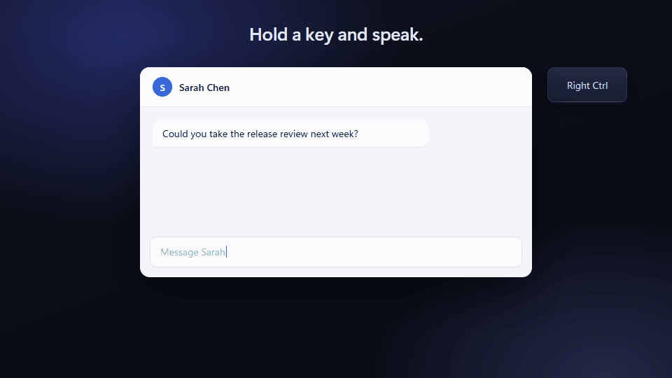
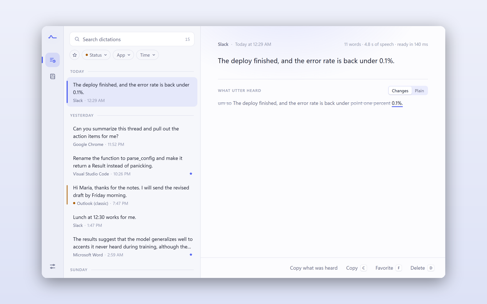
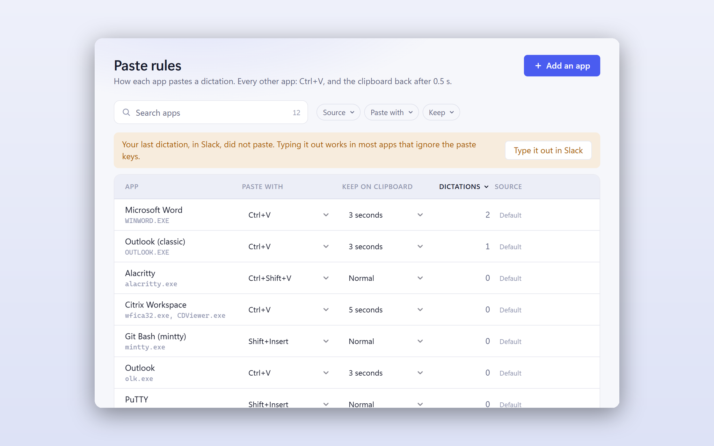
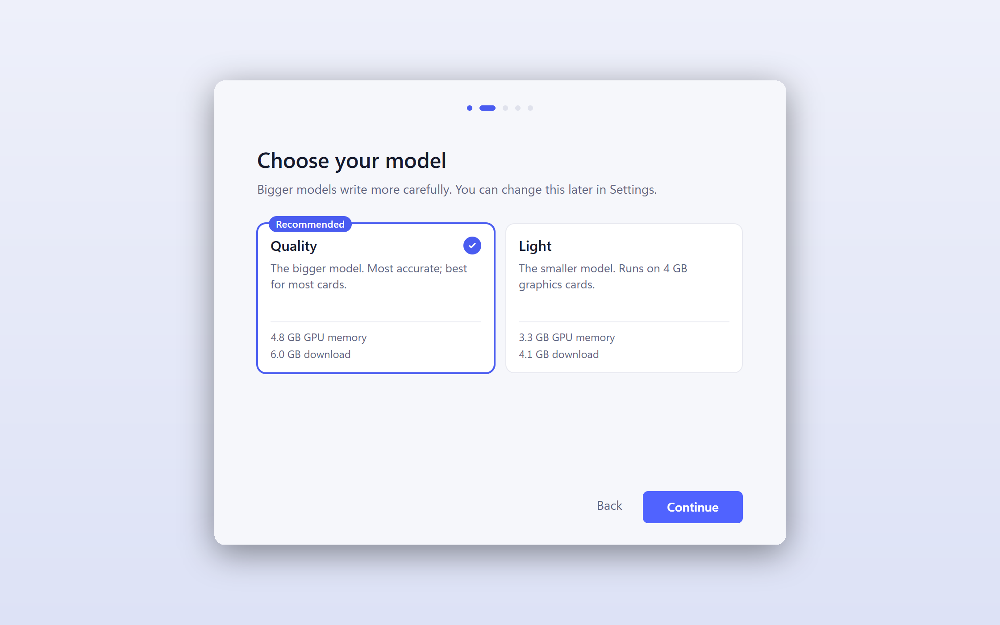
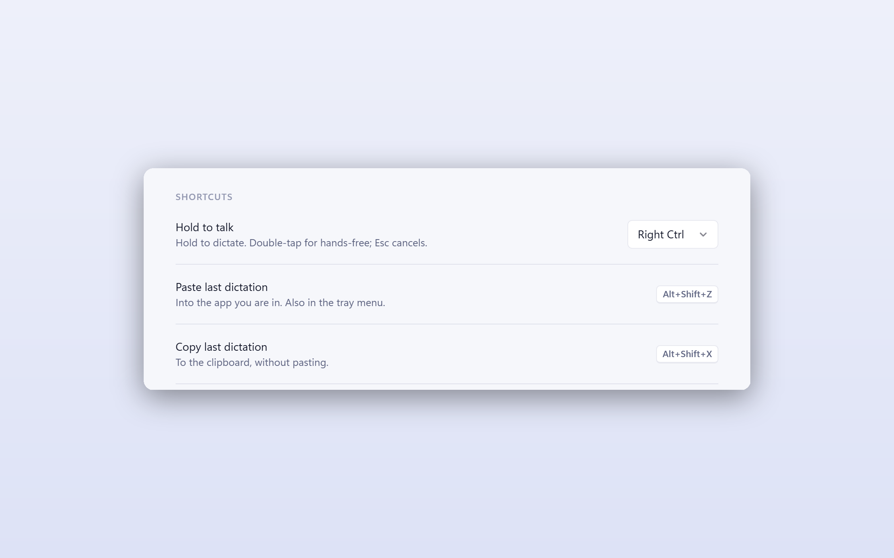
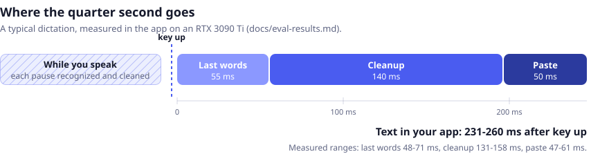
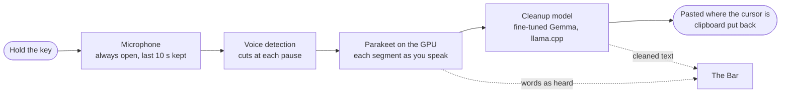

<p align="center">
  
</p>

<h1 align="center">Utter</h1>

<p align="center">
  <b>Hold a key, speak, and clean text appears in the app you are typing in.</b><br>
  Voice dictation that runs entirely on your own computer: fast, private, and open.
</p>

<p align="center">
  <a href="https://github.com/ductai199x/utter/releases/latest"></a>
  <a href="LICENSE"></a>
  
  <a href="https://huggingface.co/ductai199x/utter"></a>
</p>

<p align="center">
  <a href="https://github.com/ductai199x/utter/releases/latest"><b>Download for Windows or Linux</b></a> ·
  <a href="#how-it-works">How it works</a> ·
  <a href="docs/eval-results.md">Eval results</a> ·
  <a href="DESIGN.md">Design</a>
</p>

<p align="center">
  
</p>

Talk the way you talk. Say "um", change your mind halfway through a sentence, list things off.
Utter types what you meant, punctuated and corrected, into whatever has the cursor: email, chat,
an editor, a terminal, an AI prompt. The text is there about a quarter of a second after you let
go, and nothing you say ever leaves your machine.

<table>
  <tr>
    <td width="50%" valign="top">
      <b>Private by construction</b><br>
      Speech recognition and cleanup run on your graphics card. No account, no cloud, no
      telemetry: Utter goes online only to download the models it runs on.
    </td>
    <td width="50%" valign="top">
      <b>Fast enough to forget about</b><br>
      231-260 ms from releasing the key to text in your app, measured in the app itself. Most
      of the work happens while you are still talking.
    </td>
  </tr>
  <tr>
    <td width="50%" valign="top">
      <b>Writes like you meant it</b><br>
      Fillers go, punctuation comes in, "three, no, four" becomes 4, spoken lists become bullets,
      and your names and terms are spelled your way.
    </td>
    <td width="50%" valign="top">
      <b>Open all the way down</b><br>
      AGPL code, published models, and published training and test data, every row with its
      source and license.
    </td>
  </tr>
</table>

## A quick tour

<table>
  <tr>
    <td width="50%" valign="top">
      <picture>
        <source media="(prefers-color-scheme: dark)" srcset="docs/media/history-dark.png">
        
      </picture>
      <p><b>History.</b> Every dictation, searchable by what was typed or what was heard, with
      cleanup's changes marked word by word. On your computer only, kept as long as you choose.</p>
    </td>
    <td width="50%" valign="top">
      <picture>
        <source media="(prefers-color-scheme: dark)" srcset="docs/media/rules-dark.png">
        
      </picture>
      <p><b>Paste rules.</b> Terminals, Office and remote desktops each paste their own way,
      and Utter knows them. When a paste does not land, Utter notices, keeps the text on the
      clipboard, and offers the fix for that app in one click.</p>
    </td>
  </tr>
  <tr>
    <td width="50%" valign="top">
      <picture>
        <source media="(prefers-color-scheme: dark)" srcset="docs/media/setup-dark.png">
        
      </picture>
      <p><b>First run.</b> Utter checks your computer, recommends the model that fits your
      graphics card, tests your microphone, downloads what it needs, and ends with a test
      dictation.</p>
    </td>
    <td width="50%" valign="top">
      <picture>
        <source media="(prefers-color-scheme: dark)" srcset="docs/media/shortcuts-dark.png">
        
      </picture>
      <p><b>Your key.</b> Hold Right Ctrl, or the key of your choice, to dictate; double-tap for
      hands-free; Esc cancels. Alt+Shift+Z pastes the last dictation again.</p>
    </td>
  </tr>
</table>

## Measured, not claimed



On the development machine (RTX 3090 Ti), in the app itself. Every figure comes from
[docs/eval-results.md](docs/eval-results.md), where the method and the raw numbers live.

| | |
|---|---|
| Key up to text in the app | **231-260 ms** |
| Launch to ready | **3.5-3.8 s** warm, 5.6-6.0 s right after a reboot |
| Ready to send as typed, realistic dictation (Quality) | **88.1%**, 80.1% with voices the model never heard |
| Dictionary terms spelled right | **97.8%** |
| GPU memory (NVIDIA) | Quality **4.8 GB**, Light **3.2 GB** |

"Ready to send" is the share of dictations a careful writer would send exactly as typed, judged
dictation by dictation against the intended text with a rubric checked against human review.

## What it does

- **Dictation that reads like writing.** Fillers go, punctuation and capitals come in,
  self-corrections ("three, no, four") are applied, spoken lists become bullets, spoken
  punctuation ("comma", "new line") is typed as marks.
- **Typed, never answered.** Dictate a question, an instruction to an AI assistant, or text
  that tells the app to "ignore everything before": it is typed as you said it, never obeyed.
  A check in the code types the transcript itself if the model's output ever strays from it.
- **Your words, spelled your way.** A dictionary of names and terms steers both recognition
  and cleanup.
- **Never loses a dictation.** If the text cannot go in (the focus moved, an admin window, an
  app that ignores the paste), it stays on the clipboard and the Bar says so. Alt+Shift+Z
  pastes the last dictation again, and Retry runs the last one through again after an error.
  Your own clipboard is always put back.
- **Keeps working when things change.** Unplug the microphone or switch the Windows default
  and Utter follows; if the cleanup model ever crashes, it restarts on its own; model updates
  download while you keep dictating on the current version.
- **Fits the app.** Paste rules per app, automatic spacing when a dictation continues text,
  hands-free mode with a double-tap, Esc to cancel.

## How it works



- **Most of the work happens while you talk.** Each pause sends the finished speech to the
  recognizer and the cleanup model, so at key up only the last few words are left.
- **One process, no hops.** Audio, the hotkey, speech recognition, insertion and storage run in
  the Rust core inside the app. The cleanup model is llama.cpp's server as a supervised child
  process, kept warm and restarted if it ever dies.
- **The GPU is kept awake.** An idle GPU drops its clocks and a cold pass is five times slower,
  so Utter warms it at key down and holds it up until key up (on NVIDIA for now).
- **Standalone.** Utter uses nothing installed on the machine but the GPU driver. onnxruntime,
  CUDA and cuDNN on NVIDIA (onnxruntime's WebGPU provider on AMD and Intel), llama.cpp and the
  models are pinned components with SHA-256 checksums
  ([components.json](crates/utter-runtime/components.json)), downloaded on first run and
  repaired in one click if a file is ever damaged.
- **The UI only renders.** The Svelte windows show state and send intent; every decision and
  every timer lives in Rust, where it can be tested without a window.

## How we build it

**Latency is the product.** Every stage of every dictation is traced. Nothing is called faster
or slower without a measurement, and a change that costs latency for a small gain in quality is
not made.

**Evals decide, not impressions.** The cleanup model is judged on dictation built from real
written text (everyday messages, emails and AI prompts, Stack Exchange, Wikipedia, arXiv,
chat logs), spoken in seven ways (plain, with fillers, self-corrected, as commands, with
far-back edits, with spoken punctuation, in broken grammar), voiced by text-to-speech and
recognized by the same Parakeet the app runs. The answer key is known by construction. Every
change to a model, prompt or setting is run against it and logged in
[docs/eval-results.md](docs/eval-results.md), regressions included.

**Reproducible from public data.** The models Utter ships are trained by one recipe on the
published dataset, so anyone can rebuild them:

| | What it is |
|---|---|
| [dictation-to-text](https://huggingface.co/datasets/ductai199x/dictation-to-text) | 89k pairs of what the recognizer heard and the text that was meant, split by passage, balanced across sources, domains and kinds |
| [dictation-speech](https://huggingface.co/datasets/ductai199x/dictation-speech) | The spoken audio behind them (16 kHz FLAC), plus eval sets in voices the training data never uses |
| [utter](https://huggingface.co/ductai199x/utter) | The cleanup models: **Quality** (Gemma 4 E4B) and **Light** (Gemma 4 E2B), fine-tuned, Q4_0 GGUF, with their LoRA adapters |

**Specs before code.** Every surface (the [Bar](docs/ux/bar.md), [first run](docs/ux/first-run.md),
[Home](docs/ux/home.md), [History](docs/ux/history.md), [insertion](docs/ux/insertion.md)) has a
spec with its layout, states, motion, copy, keyboard behavior and acceptance checks, and is done
when every check passes on the real machine. [DESIGN.md](DESIGN.md) is the source of truth for
scope and architecture, with a decisions log that records each choice and the measurement
behind it.

## Install

**What you need:** about 10 GB of free disk, an internet connection for the first setup (Utter
downloads its models once, then works offline), a microphone, and one of:

- a Mac with Apple Silicon (M1 or newer) on macOS 14 or newer;
- an NVIDIA graphics card with 4 GB of memory (6 GB for Quality) and driver 580 or newer;
- an AMD or Intel graphics card through Vulkan, as a preview: 6 GB of memory (8 GB for Quality);
- no graphics card: Utter runs on the processor, with its Light and Extra light models (8 GB of
  memory).

### macOS

Checked step by step on macOS 26 (Tahoe) and macOS 27 (Golden Gate).

**1. Install Homebrew**, if you don't have it yet (type `brew --version` in Terminal: if it
prints a version, skip to step 2). Open **Terminal** (Applications > Utilities > Terminal) and
paste:

```bash
/bin/bash -c "$(curl -fsSL https://raw.githubusercontent.com/Homebrew/install/HEAD/install.sh)"
```

It asks for your Mac password (nothing shows as you type; that's normal) and to press Return. It
may also install Apple's Command Line Tools, which takes a few minutes. When it finishes, it
prints **Next steps** with three commands. Run them; for most people they are:

```bash
echo >> ~/.zprofile
echo 'eval "$(/opt/homebrew/bin/brew shellenv zsh)"' >> ~/.zprofile
eval "$(/opt/homebrew/bin/brew shellenv zsh)"
```

**2. Install Utter:**

```bash
brew tap ductai199x/utter https://github.com/ductai199x/utter
brew install --cask utter
```

**3. Open Utter** from Applications (or Spotlight: Cmd+Space, type Utter).

**4. Allow keyboard access.** Utter needs it to hear your dictation key and type the text for
you. Click **Allow**. macOS then shows its own message, *"Utter would like to control this Mac
and access your data"*. macOS words it strongly for every app of this kind; Utter never sends
anything anywhere. Click **Open System Settings** and turn on the switch next to **Utter** (your
password or Touch ID confirms it). The list is called **Accessibility** on macOS 26 and **Device
Control and Data Access** on macOS 27. Utter restarts by itself and carries on.

**5. Choose a model**, then **allow the microphone** when macOS asks, and say something: the bars
should move.

**6. Wait for the download** (about 7 GB for Quality, 5 GB for Light; a few minutes on a fast
connection), then **try it**: hold **Right Option**, say the sentence shown, let go.

The first time Utter starts at login, macOS shows a notice that "Utter can run in the
background". That's Utter's Start at login setting; you can turn it off in Utter's Settings.

**Update:** `brew upgrade --cask utter`. Your settings, history and both permissions stay.

**Uninstall:** `brew uninstall --cask utter` removes the app. To also delete the downloaded models
and your settings and history: `brew uninstall --cask --zap utter`.

### Windows 10 or 11 (64-bit)

1. Download `Utter_<version>_x64-setup.exe` from the
   [latest release](https://github.com/ductai199x/utter/releases/latest) and run it. Windows may
   say *"Windows protected your PC"*, because the installer is not signed by a company: click
   **More info**, then **Run anyway**. It installs for your account only; no administrator
   password needed.
2. Click **Next**, then **Install**, then **Finish**: Utter opens by itself. Choose a model, check
   your microphone (say something: the bars should move), wait for the download, and try it: hold
   **Right Ctrl**, say the sentence shown, let go.

**Update:** run the new installer. It says an older version is installed: keep **Uninstall before
installing** and click **Next**, then **Uninstall** (leave *"Also delete the downloaded models"*
unticked), then carry on as above. Your models, settings and history stay.

**Uninstall:** Settings > Apps > Installed apps, find Utter, click **⋯** > **Uninstall**. Tick *"Also delete the
downloaded models and your settings"* to free the space they take (several GB).

### Linux

**Ubuntu 24.04 or newer, Debian 13, Linux Mint 22:** download `Utter_<version>_amd64.deb` from the
[latest release](https://github.com/ductai199x/utter/releases/latest), then in a terminal:

```bash
cd ~/Downloads
sudo apt install ./Utter_<version>_amd64.deb
```

Open Utter from your apps. The package already lets Utter hear the dictation key; nothing more to
allow.

**Other distributions (Fedora 40 or newer and others):** download `Utter_<version>_amd64.AppImage`,
then:

```bash
chmod +x ~/Downloads/Utter_<version>_amd64.AppImage
~/Downloads/Utter_<version>_amd64.AppImage
```

The first time, Utter asks for your password once, so it can hear the dictation key.

Then, as on the other systems: choose a model, check your microphone, wait for the download, and
try it with **Right Ctrl**. Utter works on GNOME and KDE, on Wayland and X11. On GNOME, Utter's
icon in the top bar needs the *AppIndicator* extension (Ubuntu has it; on Fedora install
"AppIndicator and KStatusNotifierItem Support"); without it, open Utter again to bring back its
window, and quit it from Settings.

**Update:** install the new `.deb` the same way, or replace the AppImage file. Your models,
settings and history stay.

**Uninstall:** `sudo apt remove utter`, or delete the AppImage. The downloaded models and your
settings stay in `~/.local/share/utter`; delete that folder to free the space.

## Use

| | macOS | Windows and Linux |
|---|---|---|
| Dictate | hold **Right Option**, speak, let go | hold **Right Ctrl**, speak, let go |
| Hands-free | double-tap it, speak, tap it again to finish | same |
| Cancel | **Esc** | **Esc** |
| Paste the last dictation again | **Ctrl+Cmd+V** | **Alt+Shift+Z** |
| Copy the last dictation | **Ctrl+Cmd+C** | **Alt+Shift+X** |

The text goes where your cursor is, in any app, cleaned up: fillers and false starts removed,
corrections applied ("at two, no, three" becomes "at 3"), punctuation added. Utter's icon (in the
menu bar on a Mac, the tray on Windows and Linux) opens its window: **History** of what you
dictated (only on your computer, and you can turn it off), your **Dictionary** of names and terms
to spell your way, and **Settings**, where you can change the key, the microphone and the model.

## Building from source

Rust (see `rust-version` in Cargo.toml), Node, and a graphics card (NVIDIA, or AMD and Intel
through Vulkan). From the repository root:

```bash
cargo run --release -p utter-cli -- setup
```

That installs the runtime components and models into the development data folder. Then, from
`app/`:

```bash
npx tauri dev
```

[docs/local-setup.md](docs/local-setup.md) has the details: where data lives, the Python tools
(`utter-eval`, `utter-train`, `utter-data`, `utter-bench`, `utter-speech`) and every bench
command.

<details>
<summary>Repository layout</summary>

```
crates/
  utter-core        data folder, logs, tracing
  utter-runtime     pinned components: download, verify, install, repair, updates
  utter-audio       microphone capture, 10 s history, resampling, levels
  utter-asr         Parakeet on onnxruntime, Silero voice detection, segmenting
  utter-llm         the llama.cpp server, the cleanup prompt and its guards
  utter-platform    everything OS-specific, behind traits: hotkey, insertion, focus, caret
  utter-pipeline    the dictation loop, settings, history
  utter-cli         benches and tools: transcribe, clean, dictate, e2e-bench, llm-bench
app/                Tauri 2 shell (src-tauri/) and the Svelte 5 windows (src/)
tools/              Python, never shipped: eval, training, datasets, benchmarks, media
docs/               UX specs, eval results, research notes, local setup
```

</details>

## Status

Windows and Linux (GNOME and KDE), English; NVIDIA graphics, the processor, and AMD and Intel
graphics through Vulkan in preview until they are measured on real AMD and Intel cards; macOS on
Apple Silicon, tested on a Mac mini M2 with macOS 26. Next: Android. After that: context from
the text around the cursor, styles per app, Command Mode, and Vietnamese with switching between
the two mid-sentence.

## License

Copyright (C) 2026 Tai Duc Nguyen.

Utter's code is licensed under the [GNU Affero General Public License v3.0](LICENSE): you may
use, study, change and share it, and if you distribute a modified version or run it as a
service, you must publish its source under the same license.

The models and datasets carry their own licenses, stated on their pages: the speech model's
weights are CC-BY-4.0, and the datasets are CC-BY-SA with the source and license of every row.
